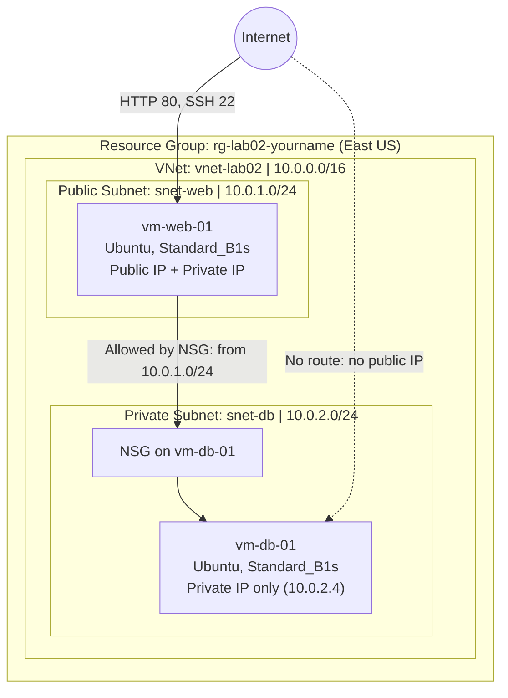
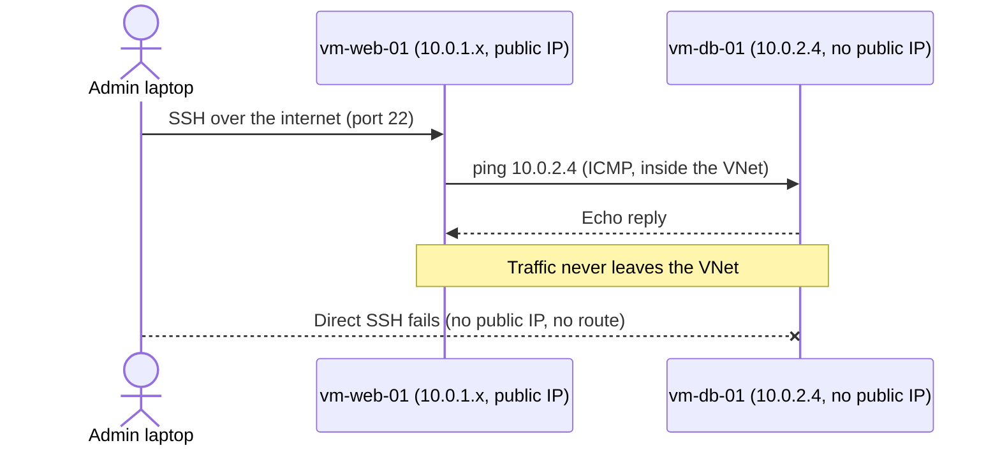

# Azure Lab 02: Secure 2-Tier Web Application (IaaS)

A hands-on build of a classic two-tier architecture on Microsoft Azure: a public-facing web server and a private database server, isolated from each other and from the internet with subnets and Network Security Groups (NSGs).

**Author:** Prince Agugo
**Lab source:** Lab 02 from the Azure course by Jhante Charles (adapted and extended with a CLI build and hardening notes)
**Cloud:** Microsoft Azure | **Region:** East US | **Difficulty:** Beginner | **Time:** ~60 min

---

## Table of Contents

1. [What I Built](#what-i-built)
2. [Architecture](#architecture)
3. [Skills Demonstrated](#skills-demonstrated)
4. [Prerequisites](#prerequisites)
5. [Naming and Addressing](#naming-and-addressing)
6. [Build It: Azure Portal](#build-it-azure-portal)
7. [Build It: Azure CLI (Repeatable)](#build-it-azure-cli-repeatable)
8. [Validation](#validation)
9. [Security Review and Hardening](#security-review-and-hardening)
10. [Troubleshooting](#troubleshooting)
11. [Cost and Cleanup](#cost-and-cleanup)
12. [Key Takeaways](#key-takeaways)
13. [Screenshots](#screenshots)

---

## What I Built

A Virtual Network (VNet) split into two subnets. The **web tier** lives in a public subnet with a public IP so users can reach it over HTTP and administrators can reach it over SSH. The **database tier** lives in a private subnet with **no public IP at all**, so the internet has no route to it. The only way to reach the database server is by "jumping" through the web server, and an NSG controls exactly who is allowed to talk to it.

This pattern is the foundation of most production cloud designs: keep the things that must face the internet small and separate, and keep data behind them.

---

## Architecture

### High-Level View



### Access Path (The "Jump")

Because `vm-db-01` has no public IP, administration goes through the web server.



### Traffic Rules at a Glance

| Source | Destination | Port | Result | Why |
|---|---|---|---|---|
| Internet | `vm-web-01` | 80, 22 | Allowed | Web NSG rules created during VM deployment |
| Internet | `vm-db-01` | Any | Blocked | No public IP, so there is nothing to route to |
| `snet-web` (10.0.1.0/24) | `vm-db-01` | Any | Allowed | `Allow-Web-Subnet` rule, priority 100 |
| Other VNet subnets | `vm-db-01` | Any | Allowed by default (see hardening) | Azure's built-in `AllowVnetInBound` rule |

---

## Skills Demonstrated

Virtual network design and CIDR planning, public vs. private subnet segmentation, NSG rule authoring and priority evaluation, VM deployment with SSH key authentication, bastion/jump-host access patterns, network connectivity testing, least-privilege security review, infrastructure scripting with Azure CLI, and cost-aware cleanup.

---

## Prerequisites

You need an active Azure subscription, a terminal with an SSH client (macOS, Linux, or Windows with OpenSSH), and permission to create resources in the subscription (Contributor on the subscription or resource group is enough). For the CLI section, install the [Azure CLI](https://learn.microsoft.com/cli/azure/install-azure-cli) and run `az login`.

---

## Naming and Addressing

| Item | Value |
|---|---|
| Resource group | `rg-lab02-<yourname>` |
| Region | East US |
| VNet | `vnet-lab02` (`10.0.0.0/16`) |
| Public subnet | `snet-web` (`10.0.1.0/24`) |
| Private subnet | `snet-db` (`10.0.2.0/24`) |
| Web VM | `vm-web-01` |
| Database VM | `vm-db-01` |
| SSH key | `key-lab02` |
| VM size | `Standard_B1s` |

A note on addressing: Azure reserves the first four addresses and the last address in every subnet, so the first VM in `snet-db` receives `10.0.2.4`. That is why the lab expects that exact IP.

---

## Build It: Azure Portal

### Phase 1: Network Foundation

1. Search for **Virtual networks** and click **Create**.
2. **Basics:** create a new resource group `rg-lab02-<yourname>`, name the VNet `vnet-lab02`, region **East US**.
3. **IP addresses:** address space `10.0.0.0/16`. Rename the default subnet to `snet-web` with range `10.0.1.0/24`, then add `snet-db` with range `10.0.2.0/24`.
4. Click **Review + create**, then **Create**.

**Expected result:** a VNet with two subnets listed under *Settings > Subnets*.

### Phase 2: Web Server (Front End)

1. Search for **Virtual machines** and click **Create**.
2. **Basics:** resource group `rg-lab02-<yourname>`, name `vm-web-01`, region East US, image **Ubuntu Server** (see the note below on versions), size `Standard_B1s`, authentication **SSH public key**, key pair name `key-lab02`.
3. **Inbound ports:** allow selected ports, **HTTP (80)** and **SSH (22)**.
4. **Networking:** VNet `vnet-lab02`, subnet `snet-web`, public IP **Create new (Standard SKU)**.
5. **Review + create**, then **Create**. Download the private key (`.pem`) when prompted and store it somewhere safe.

> **Version note:** the original lab uses Ubuntu 20.04 LTS, which has reached the end of standard support. Use Ubuntu 22.04 LTS or 24.04 LTS for anything beyond a throwaway lab.

### Phase 3: Database Server (Back End)

1. Create another VM: name `vm-db-01`, same resource group, region, image, and size.
2. **Authentication:** use the existing key `key-lab02`.
3. **Inbound ports:** SSH (22) only.
4. **Networking (critical):** VNet `vnet-lab02`, subnet **`snet-db`**, public IP **None**.
5. **Review + create**, then **Create**.

**Expected result:** `vm-db-01` shows a private IP and an empty public IP field.

### Phase 4: Validate Connectivity (The Jump)

1. Open `vm-db-01` and note its private IP (expected `10.0.2.4`).
2. SSH to the web server:

   ```bash
   chmod 400 key-lab02.pem
   ssh -i key-lab02.pem azureuser@<public-ip-of-vm-web-01>
   ```

3. From inside the web server, ping the database server:

   ```bash
   ping -c 4 10.0.2.4
   ```

**Expected output:** four replies with `0% packet loss`. This proves both servers share the VNet and can route to each other privately.

### Phase 5: Lock Down the Database with an NSG

1. Open `vm-db-01`, go to **Networking**, and click its Network Security Group.
2. Go to **Inbound security rules** and click **+ Add** with these values:

| Field | Value |
|---|---|
| Source | IP Addresses |
| Source IP addresses/CIDR | `10.0.1.0/24` |
| Source port ranges | `*` |
| Destination | Any |
| Service | Custom |
| Destination port ranges | `*` |
| Protocol | Any |
| Action | Allow |
| Priority | `100` |
| Name | `Allow-Web-Subnet` |

3. Click **Add**.

> **Honest note:** this rule is mostly documentation. Azure NSGs ship with a default `AllowVnetInBound` rule (priority 65000) that already permits traffic between resources in the same VNet. The custom rule makes the intent explicit, but it does not by itself block anything. The [hardening section](#security-review-and-hardening) shows how to make the isolation real.

---

## Build It: Azure CLI (Repeatable)

The same environment as a script. Replace `<yourname>` and run it in Bash (Azure Cloud Shell works well).

```bash
# ---------- Variables ----------
RG="rg-lab02-<yourname>"
LOC="eastus"
VNET="vnet-lab02"
ADMIN="azureuser"
IMAGE="Ubuntu2204"          # Ubuntu 22.04 LTS
SIZE="Standard_B1s"

# ---------- Phase 1: Network ----------
az group create --name "$RG" --location "$LOC"

az network vnet create \
  --resource-group "$RG" --name "$VNET" \
  --address-prefixes 10.0.0.0/16 \
  --subnet-name snet-web --subnet-prefixes 10.0.1.0/24

az network vnet subnet create \
  --resource-group "$RG" --vnet-name "$VNET" \
  --name snet-db --address-prefixes 10.0.2.0/24

# ---------- Phase 2: Web VM (public IP, SSH + HTTP) ----------
az vm create \
  --resource-group "$RG" --name vm-web-01 \
  --image "$IMAGE" --size "$SIZE" \
  --vnet-name "$VNET" --subnet snet-web \
  --public-ip-sku Standard \
  --admin-username "$ADMIN" --generate-ssh-keys

az vm open-port --resource-group "$RG" --name vm-web-01 --port 80 --priority 1010

# ---------- Phase 3: DB VM (no public IP) ----------
az network nsg create --resource-group "$RG" --name nsg-db

az vm create \
  --resource-group "$RG" --name vm-db-01 \
  --image "$IMAGE" --size "$SIZE" \
  --vnet-name "$VNET" --subnet snet-db \
  --public-ip-address "" \
  --nsg nsg-db \
  --admin-username "$ADMIN" --generate-ssh-keys

# ---------- Phase 5: NSG rule from the lab ----------
az network nsg rule create \
  --resource-group "$RG" --nsg-name nsg-db \
  --name Allow-Web-Subnet --priority 100 \
  --direction Inbound --access Allow --protocol "*" \
  --source-address-prefixes 10.0.1.0/24 --source-port-ranges "*" \
  --destination-address-prefixes "*" --destination-port-ranges "*"

# ---------- Grab what you need for validation ----------
az vm list-ip-addresses --resource-group "$RG" --output table
```

`--generate-ssh-keys` reuses an existing key in `~/.ssh` or creates one, so the same key works for both VMs. Then validate with the jump steps from Phase 4, using your default key (`ssh azureuser@<web-public-ip>`).

---

## Validation

| Check | Command | Pass condition |
|---|---|---|
| DB has no public IP | `az vm list-ip-addresses -g $RG -o table` | `vm-db-01` shows only a private IP |
| Web reachable | `curl -I http://<web-public-ip>` (after installing a web server) | Response received, not a timeout |
| Internal routing | `ping -c 4 10.0.2.4` from `vm-web-01` | 0% packet loss |
| DB not reachable from internet | `ssh azureuser@10.0.2.4` from your laptop | Times out (private address, no route) |
| Effective rules | `az network nic list-effective-nsg -g $RG --name <db-nic-name>` | `Allow-Web-Subnet` listed above the defaults |

---

## Security Review and Hardening

The lab is a solid learning scaffold, and the gaps below are exactly what I would flag in a real design review. Each one is a small change.

**1. The Allow rule is too broad.** `Allow-Web-Subnet` permits any port from the web subnet. Least privilege says allow only what the tier needs: SSH for administration and the database port once a database is installed (3306 for MySQL, 5432 for PostgreSQL).

```bash
az network nsg rule delete -g "$RG" --nsg-name nsg-db -n Allow-Web-Subnet

az network nsg rule create -g "$RG" --nsg-name nsg-db -n Allow-SSH-From-Web \
  --priority 100 --direction Inbound --access Allow --protocol Tcp \
  --source-address-prefixes 10.0.1.0/24 --source-port-ranges "*" \
  --destination-address-prefixes "*" --destination-port-ranges 22

az network nsg rule create -g "$RG" --nsg-name nsg-db -n Allow-DB-From-Web \
  --priority 110 --direction Inbound --access Allow --protocol Tcp \
  --source-address-prefixes 10.0.1.0/24 --source-port-ranges "*" \
  --destination-address-prefixes "*" --destination-port-ranges 5432
```

**2. Add an explicit deny so the isolation is real.** Because of the default `AllowVnetInBound` rule, any other subnet in the VNet could still reach the database. A deny rule at a lower priority than your allows (a higher number) closes that gap.

```bash
az network nsg rule create -g "$RG" --nsg-name nsg-db -n Deny-All-Other-Inbound \
  --priority 4000 --direction Inbound --access Deny --protocol "*" \
  --source-address-prefixes "*" --source-port-ranges "*" \
  --destination-address-prefixes "*" --destination-port-ranges "*"
```

NSG rules are evaluated lowest priority number first, and the first match wins, so the allows at 100 and 110 are checked before the deny at 4000.

**3. Do not copy private keys onto servers.** The lab mentions copying the `.pem` to the web server to SSH onward. Don't. Use SSH agent forwarding or a ProxyJump instead, so the key never leaves your laptop:

```bash
ssh -J azureuser@<web-public-ip> azureuser@10.0.2.4
```

**4. Restrict SSH on the web server.** Port 22 open to `Any` invites constant brute-force scanning. Set the source of the SSH rule to your own public IP (`<your-ip>/32`), or better, remove public SSH entirely and use **Azure Bastion** or Just-In-Time VM access.

**5. Prefer Standard-SKU public IPs, current OS images, and encryption defaults.** The lab already uses a Standard public IP. Keep the OS patched (`sudo apt update && sudo apt upgrade -y`) and use a supported Ubuntu LTS release.

**6. Production next steps.** Swap the single web VM for a load balancer plus a scale set, move the database to a managed service (Azure Database for PostgreSQL or MySQL) over a private endpoint, add a NAT Gateway for controlled outbound access from the private subnet, and send NSG flow logs to a Log Analytics workspace.

---

## Troubleshooting

| Symptom | Likely cause | Fix |
|---|---|---|
| Ping to `10.0.2.4` fails | `vm-db-01` deployed into the wrong subnet or VNet | Check `vm-db-01 > Networking` and confirm VNet `vnet-lab02`, subnet `snet-db` |
| Ping fails after adding custom NSG rules | A deny rule or a rule with a lower priority number is overriding the allow | Review effective rules; lower number wins |
| Cannot SSH to `vm-db-01` from laptop | Expected: no public IP | Jump through `vm-web-01` (`ssh -J`) |
| `Permission denied (publickey)` | Wrong key, or key permissions too open | `chmod 400 key-lab02.pem` and confirm you pass `-i` |
| `WARNING: UNPROTECTED PRIVATE KEY FILE` | Key file permissions too permissive | `chmod 400 key-lab02.pem` |
| `Standard_B1s` unavailable in the region | Capacity or SKU restriction | Try `Standard_B1ls` or `Standard_B2s`, or another zone/region |
| Web page times out | HTTP (80) not allowed, or no web server installed | Open port 80 on the web NSG and run `sudo apt install -y nginx` |

---

## Cost and Cleanup

The two B1s VMs and the Standard public IP are small but bill by the hour, and the disks and public IP keep billing even if the VMs are only stopped from inside the OS. Delete everything when you finish.

```bash
az group delete --name "rg-lab02-<yourname>" --yes --no-wait
```

Deleting the resource group removes the VMs, disks, NICs, public IP, NSGs, and VNet in one step. Confirm with `az group exists --name "rg-lab02-<yourname>"`, which should return `false` once deletion completes.

---

## Key Takeaways

Subnets are the unit of segmentation, and a missing public IP is the strongest "firewall" there is. NSGs are evaluated by priority, with the first match winning, and Azure's default rules allow all intra-VNet traffic, so a private tier needs an explicit deny to be truly isolated. A jump host is a controlled front door for administration, and the key should stay on your machine. Finally, writing the build as a script turns a one-time click-through into something repeatable, reviewable, and easy to tear down.

---

## Screenshots

Add screenshots to `docs/images/` and reference them here for the presentation.

| Screenshot | What to capture | File |
|---|---|---|
| VNet and subnets | *Settings > Subnets* showing both ranges | `docs/images/01-vnet-subnets.png` |
| DB VM networking | Private IP only, no public IP | `docs/images/02-db-no-public-ip.png` |
| Successful ping | Terminal output with 0% packet loss | `docs/images/03-ping-success.png` |
| NSG rules | Inbound rules on the DB NSG | `docs/images/04-nsg-rules.png` |
| Cleanup | Resource group deleted | `docs/images/05-cleanup.png` |

```markdown

```

---

## Repository Layout

```text
.
├── README.md
├── scripts/
│   └── deploy-lab02.sh      # CLI build from this README
└── docs/
    └── images/              # Screenshots
```
